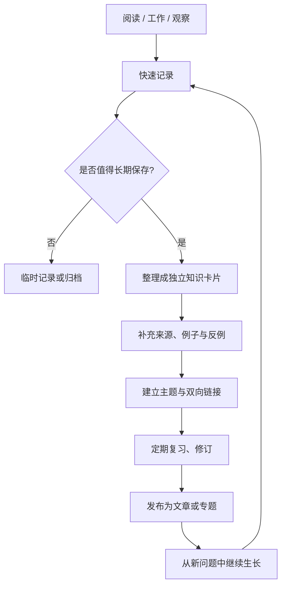

# About｜个人知识与思考

> 一个持续积累、持续整理、持续发布的个人知识空间。  
> 站点：<https://about.likui.info> · 源码：<https://github.com/ilikui/About>

## 项目定位

本仓库基于 **Hexo + Markdown** 构建。它不仅用于发布文章，也用于沉淀读书笔记、思维模型、技术学习记录与个人思考。

## 内容地图

| 内容方向 | 用途 | 建议写法 |
| --- | --- | --- |
| 读书笔记 | 记录书籍中的观点、证据与疑问 | 观点卡片、原文摘录、个人解释 |
| 思维导图 | 梳理复杂主题和概念关系 | Mermaid、层级列表、对比表 |
| 技术学习 | 沉淀可复用的技术知识 | 背景 → 原理 → 示例 → 常见问题 |
| 个人思考 | 记录观察、判断与行动复盘 | 现象 → 假设 → 证据 → 结论 |
| 学习计划 | 将知识转化为持续行动 | 目标、任务、验收标准、复盘 |

## 知识流转



## 目录说明

- `source/_posts/`：Hexo 正式发布的 Markdown 文章。
- `source/about/`：关于页面。
- `content/`：用于整理和孵化中的知识内容；新增内容前应确认是否需要同步发布到 `source/_posts/`。
- `.github/workflows/deploy.yml`：构建与 GitHub Pages 发布流程。
- `public/`：Hexo 生成目录，不建议手工编辑；以源 Markdown 为准。

## 本地预览

需要 Node.js 22 和 npm：

```bash
npm ci
npm run server
```

浏览器打开 <http://localhost:4000>。

## 构建与检查

```bash
npm ci
npm run clean
npm run build
```

构建成功后，检查 `public/index.html` 是否存在。提交到 `main` 会触发 GitHub Actions；也可以在仓库的 **Actions** 页面手动运行工作流。

## 写作规范

1. **一篇文章回答一个核心问题。** 标题尽量具体，避免只有“随笔”“资料”等无法检索的名称。
2. **先写自己的理解，再附来源。** 引用、摘录与个人观点应明确区分。
3. **让知识可复用。** 重要概念补充定义、适用条件、例子、反例和相关链接。
4. **图解服务于理解。** 复杂流程优先使用 Mermaid；图后说明关键节点和结论。
5. **持续维护。** 发现错误时直接修订，并在必要时记录更新时间和变更原因。
6. **发布前自检。** 检查标题、日期、链接、代码块、图片路径和敏感信息。

## 新建文章

可在 `source/_posts/` 新建 Markdown 文件，例如：

```markdown
---
title: 一个具体的问题
date: 2026-10-24 10:00:00
tags:
  - 学习
categories:
  - 知识管理
---

## 问题

我想解释的核心问题是什么？

## 结论先行

用一到三句话写清自己的理解。

## 推理与证据

- 关键概念：
- 依据或来源：
- 例子与反例：

## 关联知识

- 相关主题：
- 仍待回答的问题：
```

## 部署说明

工作流会先安装依赖并构建静态站点，再上传 Pages artifact 并部署。若构建成功但在 **Configure GitHub Pages** 步骤失败，请检查仓库 **Settings → Pages** 是否已启用 GitHub Pages，并将构建与部署来源设置为 **GitHub Actions**。仓库 token 权限不足时，不应在工作流中尝试自动创建 Pages 站点。

---

持续积累，持续创造。
