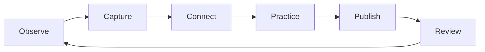

# About · Personal Knowledge Garden

<p align="center">
  <strong>A personal space for engineering, learning, reading, and thoughtful creation.</strong>
  <br />
  <a href="https://about.likui.info">Live Website</a> ·
  <a href="https://github.com/ilikui/About">Source Code</a> ·
  <a href="https://wiki.likui.info/">Knowledge Base</a>
</p>

<p align="center">
  
  
  
  
</p>

---

## Overview

**About** is a personal knowledge garden built with Hexo and Markdown. It brings together engineering notes, open-source projects, reading reflections, and ideas in progress—turning long-term learning into a connected, reusable body of work.

The design follows an editorial approach: clear typography, restrained color, responsive layouts, and direct paths to the content that matters.

## Explore

| Area | What you'll find |
| --- | --- |
| Engineering | Embedded systems, automotive software, AUTOSAR, autonomous driving, and practical tooling |
| Knowledge | Topic maps, linked notes, reading records, and knowledge-management experiments |
| Writing | Technical articles, learning notes, and reflections |
| Projects | Source code, experiments, and reusable learning resources |

## Knowledge workflow



## Local development

Requirements: Node.js 22 and npm.

```bash
git clone https://github.com/ilikui/About.git
cd About
npm ci
npm run server
```

Open [http://localhost:4000](http://localhost:4000) to preview the site.

## Build and deployment

```bash
npm ci
npm run clean
npm run build
```

The GitHub Actions workflow builds the static site and deploys the generated `public/` directory to GitHub Pages when changes are pushed to `main`. It can also be started manually from the **Actions** tab.

Netlify (about.likui.info) builds from source as configured in `netlify.toml`: it runs `npm run clean && npm run build` on Node.js 22 and publishes the freshly generated `public/` directory.

For deployment failures, check the workflow logs and confirm that **Settings → Pages → Build and deployment** is configured to use **GitHub Actions**.

## Repository map

- `source/_posts/` — published articles
- `source/about/` — profile page
- `themes/cactus/layout/index.ejs` — custom homepage structure
- `themes/cactus/source/css/_extend.styl` — responsive theme extensions
- `.github/workflows/deploy.yml` — automated build and deployment

## Principles

- **Understand before collecting.** Prefer clear explanations over link accumulation.
- **Connect ideas.** Use references and Mermaid diagrams to make relationships visible.
- **Build to learn.** Turn useful knowledge into code, tools, and practical examples.
- **Publish with care.** Keep the site accessible, responsive, and easy to maintain.

---

<p align="center"><em>持续积累，持续创造。</em></p>
