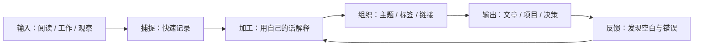
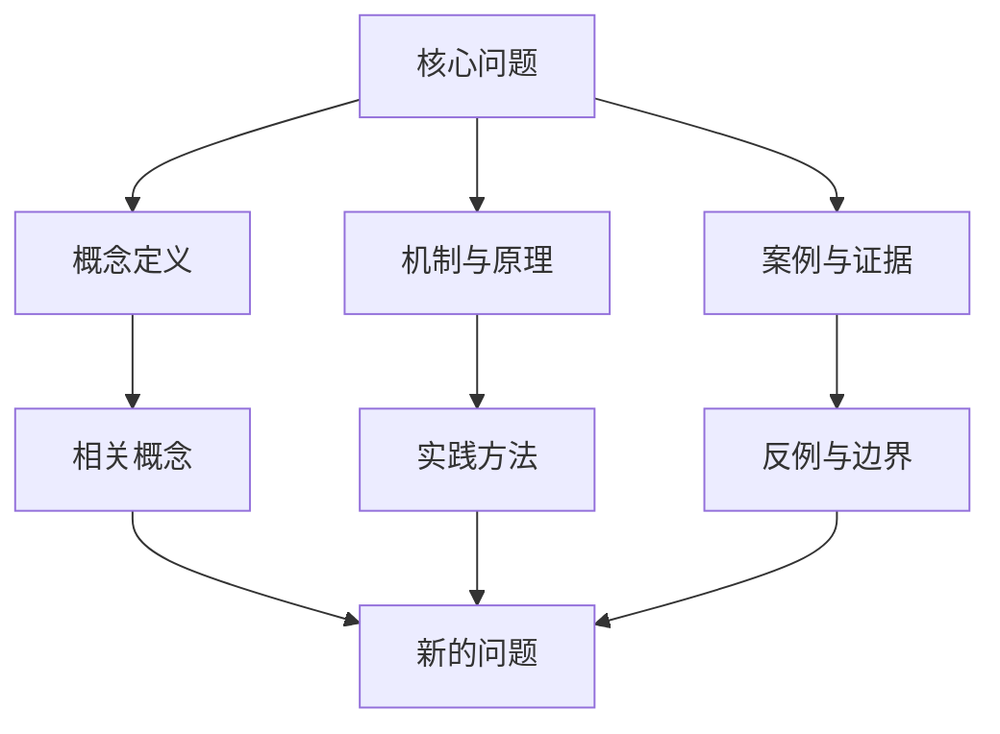

> 笔记的价值不在于保存了多少信息，而在于未来能否重新找到、理解、连接并使用它们。

## 一、让笔记形成闭环

个人知识库可以看作一条持续循环的工作流：捕捉信息、澄清理解、组织连接、复习修订，最后通过写作或实践检验知识。



## 二、区分三类笔记

| 类型 | 主要目标 | 内容特点 | 何时使用 |
| --- | --- | --- | --- |
| 临时笔记 | 不丢失想法 | 简短、允许不完整 | 阅读或工作过程中 |
| 文献笔记 | 保留来源信息 | 记录书籍、文章、作者与页码 | 需要追溯证据时 |
| 永久笔记 | 形成自己的知识 | 一个核心观点，独立可理解，可连接 | 未来可能再次使用时 |

不要把摘录直接当作自己的结论。可以保留原文，但应补上“它意味着什么”“我是否认同”“适用条件是什么”。

## 三、用问题组织知识

与其只建立“编程”“读书”“工作”等宽泛文件夹，不如从问题出发：

- 为什么这个机制会这样工作？
- 它解决了什么问题，又引入了什么代价？
- 哪些条件下结论不成立？
- 这条知识与已有的哪条笔记冲突或互补？
- 我能否用一个例子解释给别人听？

问题可以成为文章标题，也可以成为主题索引的入口。

## 四、建立可维护的知识网络



链接不是越多越好。每条链接都应该说明关系，例如“解释了这个概念”“提供反例”“适用于某个场景”或“与此观点存在冲突”。

## 五、可复用的卡片模板

```markdown
---
title: 为什么……
date: YYYY-MM-DD
tags:
  - 主题
---

## 核心结论

用自己的话表达一个可讨论、可验证的观点。

## 解释

说明概念、因果机制与适用条件。

## 例子

给出一个具体场景，避免只停留在抽象描述。

## 反例与边界

哪些情况不适用？还有哪些竞争性解释？

## 来源

记录作者、书名或文章链接；摘录注明页码或位置。

## 关联

- 支持：
- 反驳：
- 延伸问题：
```

## 六、每周维护一次

1. 清理无法理解的临时记录。
2. 为有价值的摘录补充自己的解释。
3. 合并重复观点，但保留重要的不同语境。
4. 给核心笔记添加有意义的链接。
5. 选择一条笔记用于写作、实践或讨论。
6. 记录本周仍然没有解决的问题。

## 结语

知识库不是一次性整理完成的资料仓库，而是一个随理解不断变化的系统。最好的结构不是最复杂的结构，而是能帮助你持续提出好问题、形成可靠判断，并把知识用于真实任务的结构。
