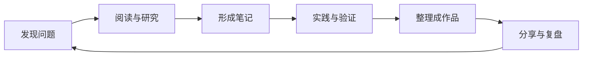

# 关于这个空间

你好，我是 Kui。

这里是我的个人知识花园，也是一个不断生长的数字工作台。我关注工程问题如何被解决、知识如何被组织，以及阅读和实践如何改变我们理解世界的方式。

我相信：真正有价值的积累，不只是保存信息，而是建立连接、反复验证，并最终创造出可以被他人使用的东西。

## 01 / 我在探索什么

  

### 技术与工程

嵌入式软件、汽车电子、AUTOSAR、自动驾驶与软件工具链。关注系统原理、工程实践、可复现的示例与可靠的交付。

  

  

### 知识与阅读

卡片笔记、主题研究、阅读记录与知识图谱。让问题成为入口，让笔记之间产生连接，让知识在实践中持续更新。

  

  

### 创作与实践

开源项目、个人工具、技术文章与学习手册。尽可能把想法做出来，把经验写清楚，并通过迭代让作品变得更好。

  

## 02 / 我的工作方式

我倾向于从具体问题出发：先弄清背景和约束，再查阅可靠资料、拆解原理，通过代码或实际案例验证，最后将结论整理成可复用的文档。

## 03 / 数字空间

| 空间 | 用途 |
| --- | --- |
| [GitHub](https://github.com/ilikui) | 开源项目、学习仓库与工程实践 |
| [个人知识库](https://wiki.likui.info/) | 专题笔记、知识卡片与关联图谱 |
| [文章归档](/archives/) | 技术文章、阅读记录与阶段性思考 |
| [个人主页](https://likui.info/) | 项目导航与个人数字空间 |

## 04 / 站点索引

- [RSS 阅读](https://rss.zzek.cn/) — 信息阅读与订阅
- [个人博客](https://blog.likui.info/) — 文章与日常记录
- [学习网站](https://r.likui.info/) — 学习手册与参考资料
- [月牙博客](https://blog.yueya.info/) — 个人博客
- [Git 服务](http://git.yueya.info/) — 程序托管

---

> **持续积累，持续创造。**
>
> 让每一次记录，都成为下一次思考的起点。
